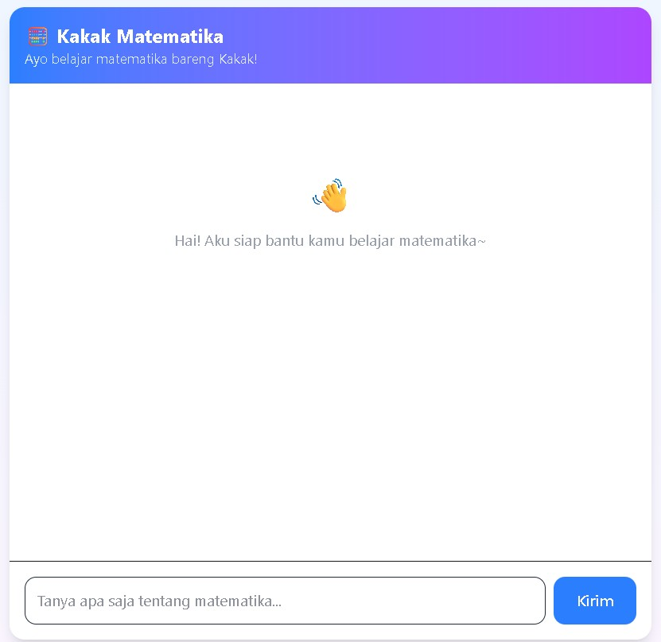
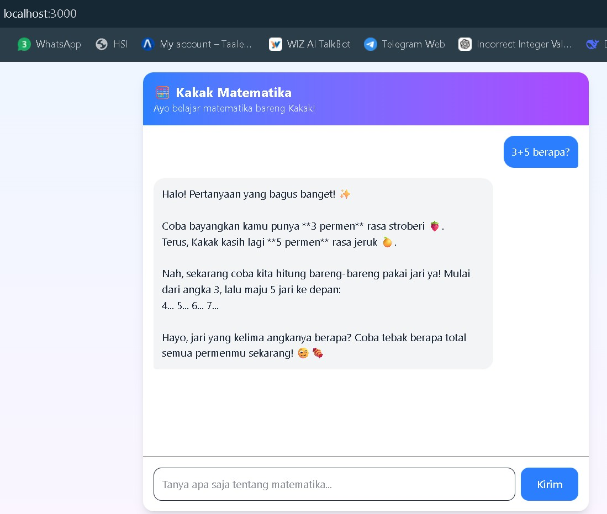
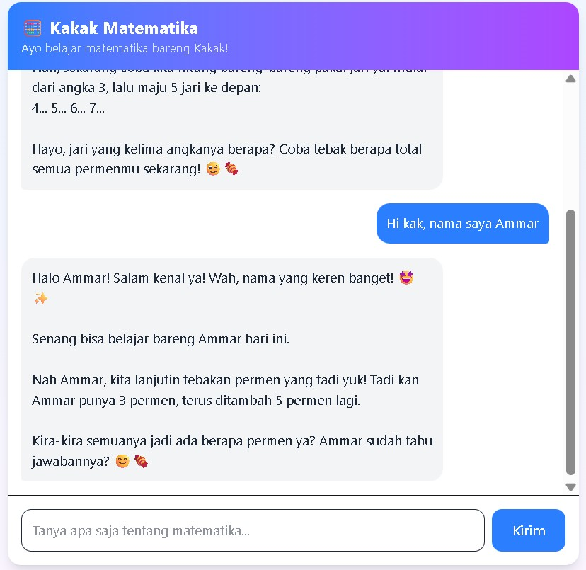
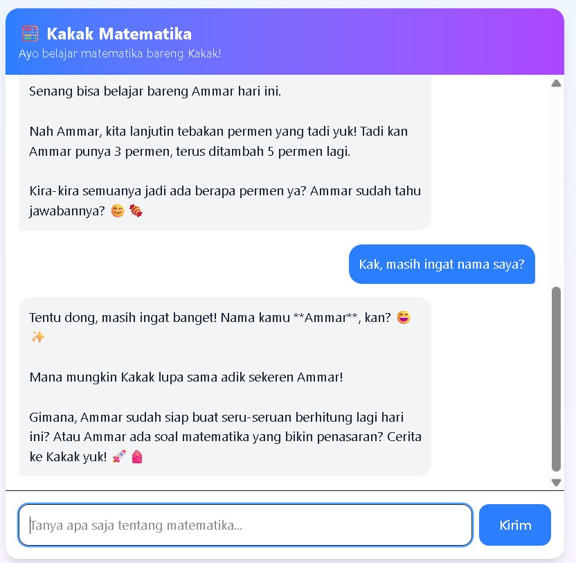

# 🧮 Kakak Matematika

> Chatbot AI ramah anak untuk membantu siswa SD (usia 7–12 tahun) belajar matematika dengan cara yang menyenangkan.


---

## 📖 Tentang Proyek

**Kakak Matematika** adalah chatbot berbasis AI yang dirancang khusus untuk anak Sekolah Dasar (SD) berusia 7–12 tahun. Alih-alih memberikan jawaban langsung, "Kakak" membimbing anak berpikir melalui:

- 🎨 **Perumpamaan sehari-hari** — permen, pizza, uang jajan
- 🧠 **Metode Socratic** — memancing dengan pertanyaan
- 😊 **Bahasa santai & hangat** — seperti kakak sendiri
- ✨ **Emoji** — bikin belajar tidak membosankan

---

## ✨ Fitur

- 🎓 **Persona ramah anak** — "Kakak Matematika" dengan gaya bahasa santai
- 💬 **Memory percakapan** — bot ingat nama & konteks sebelumnya
- 🧩 **Bimbingan bertahap** — tidak langsung memberi jawaban
- 🌈 **UI modern** — gradient lembut, rounded, nyaman dilihat anak
- ⚡ **Streaming-ready** — arsitektur mendukung respons cepat

---

## 🛠️ Teknologi

| Layer | Teknologi |
|-------|-----------|
| Framework | Next.js 16 (App Router + Turbopack) |
| Styling | Tailwind CSS 4 |
| AI Model | Google Gemini (`gemini-3.8-flash`) |
| SDK | `@google/genai` |
| Bahasa | TypeScript |

---

## 🚀 Cara Menjalankan

### 1. Clone repository
```bash
git clone https://github.com/wahcahyono76/kakak-matematika.git
cd kakak-matematika
```

### 2. Install dependencies
```bash
npm install
```

### 3. Dapatkan API Key Gemini
Kunjungi [Google AI Studio](https://aistudio.google.com/apikey), buat API Key gratis.

### 4. Buat file `.env.local`
Di root proyek, buat file `.env.local`:
```bash
GEMINI_API_KEY=your_api_key_here
```

### 5. Jalankan server
```bash
npm run dev
```

### 6. Buka di browser
```
http://localhost:3000
```

---

## 📸 Screenshot

### Tampilan Awal


### Percakapan dengan Kakak




### Memory Percakapan


---

## 🧠 Cara Kerja Memory

Chatbot ini menggunakan fitur **server-side state** dari Gemini Interactions API:

1. Setiap permintaan ke `/api/chat` mengembalikan `interactionId`
2. Frontend menyimpan `interactionId` di state
3. Permintaan berikutnya menyertakan `previousInteractionId`
4. Gemini otomatis melanjutkan konteks percakapan

Implementasi ada di:
- `src/app/api/chat/route.ts` — backend
- `src/app/page.tsx` — frontend (state management)

---

## 📁 Struktur Proyek

```
kakak-matematika/
├── app/
│   │   ├── api/chat/route.ts       # Endpoint API Gemini
│   │   ├── layout.tsx              # Layout global
│   │   ├── page.tsx                # Halaman utama chat
│   │   └── globals.css             # Style global
│   ├── components/
│   │   ├── ChatHeader.tsx          # Header gradient
│   │   ├── ChatBubble.tsx          # Bubble pesan
│   │   └── ChatInput.tsx           # Input & tombol kirim
│   └── lib/
│       └── systemInstruction.ts    # Prompt persona "Kakak"
├── public/
│   └── screenshots/                # Screenshot untuk README
├── .env.local                      # API key (TIDAK di-commit)
└── README.md
```

---

## 🎯 Contoh Percakapan

**User:** `3 + 5 berapa?`

**Kakak Matematika:**
> Halo! Pertanyaan yang bagus banget! ✨
> Coba bayangkan kamu punya 3 permen rasa stroberi 🍓. Terus, Kakak kasih lagi 5 permen rasa jeruk 🍊.
> Nah, sekarang coba kita hitung bareng-bareng pakai jari ya! Mulai dari angka 3, lalu maju 5 jari ke depan: 4... 5... 6... 7...
> Hayo, jari yang kelima angkanya berapa? Coba tebak berapa total semua permenmu sekarang! 🤔🍓

---

## 📝 Lisensi

MIT License — bebas digunakan untuk pembelajaran.

---

## 🙏 Kredit

Dibuat sebagai proyek akhir kelas **AI Productivity and AI API Integration for Developers** — Hacktiv8.